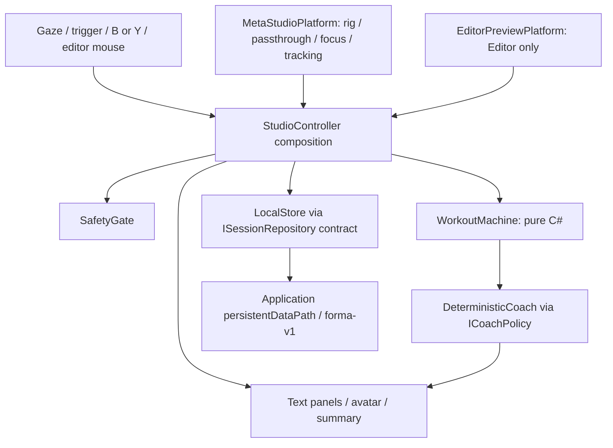
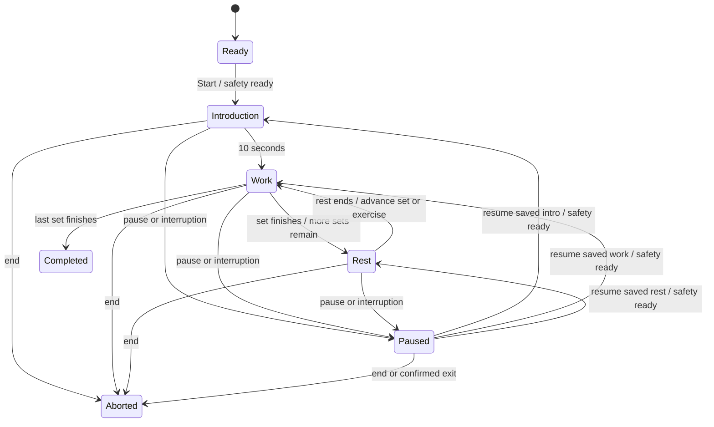

# FORMA Studio architecture

## Scope and requirements
Phase 1 is an offline, single-user MR scene. A session must progress deterministically without cloud access. Rendering, headset tracking and avatar animation must not own workout time or transition rules. Quest 3 and 3S are target devices, not validated devices. No exercise uses equipment or requires precise tracking of limbs. All future modules remain contracts.

## Dependency direction

Domain has no Unity/platform references. `Forma.Runtime` depends on domain and Unity. `Forma.Meta` depends on runtime and the Meta `Oculus.VR` assembly and only compiles with `FORMA_META_XR`. Editor authoring uses reflection solely to compose that optional integration; runtime uses a typed adapter. No platform API is scattered through the domain. The composition root currently constructs `LocalStore` directly for simplicity; the repository contract permits a fake or later injected implementation.

## Workout state machine

`WorkoutMachine.Tick` accepts elapsed seconds from the caller, rejects invalid values, carries overshoot between phases and stops at terminal states. Paused time never increments work duration. A completed set means its timed interval elapsed; it does not establish exercise quality, repetitions or exertion. Restart creates a new machine and session ID. Selection cannot change during a session. The default 135 seconds comprises 10 intro + 80 work + 45 rest. Selected single-movement sessions take 65 seconds.

The Unity controller uses a monotonic real-time clock rather than scaled time. Any frame gap over one second pauses instead of silently skipping intervals. Application focus loss, suspension or platform readiness loss pauses and clears environmental confirmation. Returning to the app never resumes automatically. Headset availability and passthrough initialization are necessary signals, not proof that a person can see a safe room.

## Coach state machine
`ICoachPolicy.Evaluate` projects workout state into Welcome, Guiding, Recovering, Paused, Celebrating or Stopped. Pausing interrupts guidance immediately. Resume returns to the original movement/rest cue. Guidance includes movement name, small ranges, comfortable pace and a stop option. The avatar freezes while paused and animates only during work. Cues are text, not generated dialogue. A future AI may suggest optional plans through a distinct contract; it cannot bypass the deterministic workout or safety gate.

## Scene and input composition
The Editor creates two separate scenes. Preview uses an Editor-only readiness provider that always fails in a player build. Quest uses the installed Meta rig, reconstructed passthrough underlay at full opacity, transparent camera background and no skybox or opaque floor. A stylized coach stands outside the workout panel. World-space primitive buttons use colliders and a visible gaze ray; either trigger selects, either B/Y secondary button pauses. Unity XR input abstracts controller APIs. The history panel sits to the side. No artificial locomotion, recentering routine or immersive transition is provided. Default room positions must be validated and adapted on hardware; they are not collision-checked against the physical room.

## Storage and privacy
`LocalStore` writes schema-v1 JSON under `Application.persistentDataPath/forma-v1`, with separate `profile.json` and `sessions/<guid>.json`. Profile stores only local ID and selected movements. Sessions store UUID, UTC timestamps, outcome, elapsed work time, finished intervals and optional self-reported repetitions/load per selected movement. No identity, motion samples, camera images, biometric inference or network transport exists.

Writes use a temporary file, flush and same-volume atomic replace. Re-saving the same UUID updates the same session. Invalid JSON/unknown schema files are skipped on reads; saving failures show a user-facing message and block replacement of the current session on a new start/selection. Checkpoints are written at start, pause and interval transitions; unfinished sessions are explicitly `Interrupted` and not automatically resumed after process death. `endedUtc` is populated only at normal terminal transitions. A crash may lose work time since the last transition; exact live recovery is out of scope. No silent migration of newer schemas occurs. Deleting local data requires two actions and no active session.

This is local storage, not application-level encryption. The OS sandbox protects normal access; device backups, ADB, uninstall retention policies and shared-device use require deployment review. History currently loads all files and displays the latest four; retention/paging and multiple profiles are future work.

## Future interfaces only
`IPersonalizedCoach`, `IBodyTracking`, `IExerciseRecognition`, `IFormaWorlds`, `IFormaMirror`, `IEquipmentProfiles`, `IVoiceInteraction`, and `IProgressAnalytics` declare narrow seams. They have no implementations. Tracking availability never implies measured full-body accuracy. Recognition must be explicitly validated before returning counts. Equipment load remains manually configured. The Worlds contract exposes active-session/equipment eligibility; no transition path exists in Phase 1.

## Decisions and revisit points
Use a single scene to avoid lifecycle races and unnecessary state transport. Keep the built-in renderer for a small transparent-underlay prototype; measure fill cost, readability and frame timing before choosing URP. Primitive coach art avoids proprietary avatar assets and keeps offline operation simple; replace only after reviewing animation validity and asset rights. Use manual confirmation plus provider readiness instead of speculative room understanding; validate the limitations with supervised hardware tests. Keep SDKs external to source and commit only genuinely resolved package locks after Editor import. Revisit persistence retention, accessible input, audio cues, storage encryption and production dependency updates before a broader trial.
