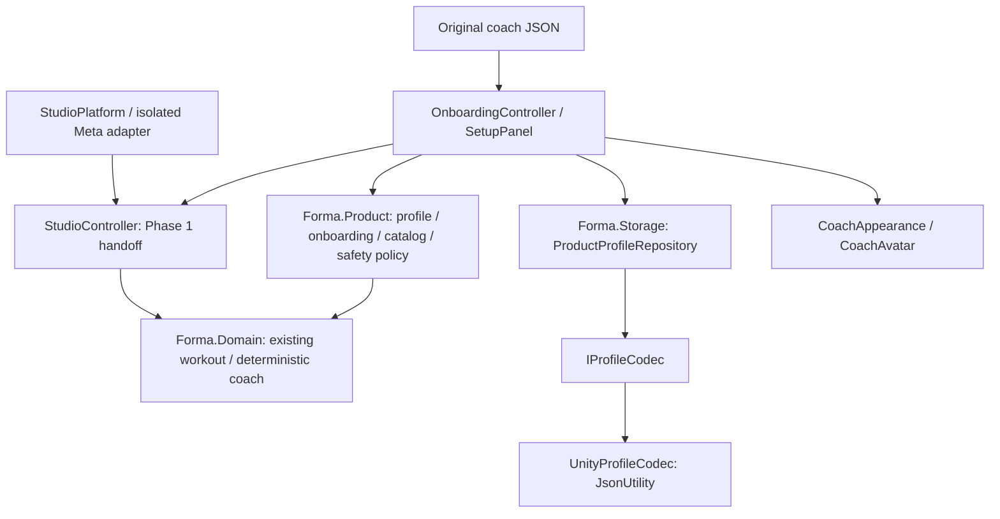

# Phase 2 product architecture

See [ADR-002](../decisions/ADR-002-product-foundation.md) for decisions and the [initial audit](AUDIT.md) for the baseline. The original [Studio architecture](../ARCHITECTURE.md) still describes the unchanged workout engine. This document adds A/B product boundaries.

## Core domain and application rules
ProductProfile is a versioned data DTO with explicit validation and copies at boundaries. Fitness preferences do not establish diagnosis or a personalized exercise prescription. ExerciseCatalog wraps the existing reviewed starter movements with category, equipment/tracking requirements, safety notes, demonstration references, seated availability and manual fallback. The beginner validator rejects unknown IDs, incompatible limitations, duplicate movements, unreviewed names/instructions and unsupported timed dose. This fixed allowlist is intentionally narrow; it is not a general medical workout validator.

OnboardingFlow owns navigation, optional profile skipping, safety acknowledgement, interruption behavior and save-before-completion. The UI edits validated copies rather than exposing mutable flow state. Every application launch starts with unconfirmed physical space. Existing completed setup allows Studio entry, never an automatic workout start.

## XR presentation and tracking
SetupPanel builds a real Unity panel with world-space text and physics targets. StudioSceneBuilder composes it into both real-Editor scene paths. Existing controller gaze selection and B/Y pause remain. Repositioning is manual, requires another environmental check, and has no physical-room collision detection. Hand-select integration is absent and explicitly not advertised. Optional body tracking/recognition remain contracts only; no new sensor permissions or Movement SDK dependencies are introduced.

StudioController consumes a completed profile, filters exercise availability (including seated shoulder-roll guidance), and continues to use its deterministic state machine. Invalid profile/no compatible catalog movement blocks starting. Replacing the Ready/terminal machine after setup preserves the terminal session first, so a new profile cannot rewrite a completed record as an empty interrupted session. Existing scenes without the new component retain their original behavior; newly generated scenes require setup.

## Coach and AI boundary
JSON defines three original presets (ID/name, procedural asset URI, personality default, text-only voice, languages, animation configuration, Studio mode and palettes). Users can choose appearance and personality independently. OfflineCoachDialogue returns fixed text; ConfiguredOfflineCoach changes only introduction phrasing and preserves shared safety/exercise guidance. No speech/listening capability is claimed.

ICoachDialogueService, IWorkoutRecommendationService, ICoachContextProvider, IVoiceInputService and IVoiceOutputService are replaceable seams. Offline recommendations use only the catalog/policy, and disabled voice fallbacks do not activate hardware. There are no API keys, remote calls, model inference or backend. Any future recommendation must be validated again; no AI service owns workout transitions.

## Platform service boundary
IAuthenticationService, IStoreAppEntitlement, IPurchaseService, ICloudSyncService, ITelemetryService and ICrashReportingService are architecture contracts, not working account/commerce services. DevelopmentEntitlements is a deterministic, unwired feature-tier test provider. Safety, stop, exit and deletion are always allowed for every tier. It is not receipt verification, app ownership validation, a checkout UI or a substitute for the required store entitlement integration.

## Persistence and privacy
ProductProfileRepository takes an injected IProfileCodec and writes a schema-2 product-profile.json alongside, without changing schema-1 Phase 1 files. Atomic same-volume replacement and explicit load statuses separate missing, loaded, invalid, unsupported and unavailable data. Invalid/newer data is preserved until explicit reset; a failed save cannot complete onboarding. Tests execute this same file repository with a .NET codec; Unity JsonUtility tests remain distinct and unrun here.

Profile-only export is user-triggered, local plaintext and developer-accessible over ADB. Complete local deletion also removes new profile/exports. Retention and outstanding consumer data controls are documented in [privacy](PRIVACY.md).

## Deferred
Milestone C adds warm-up, skip, durable checkpoint restoration/recovery and richer workout localization only after A/B Unity/device acceptance. D/E/F/G/H remain later milestones, apart from contracts and planning documents explicitly supplied here. No Zen Summit, ghost replay, billing, cloud identity, production audio or monetization backend is implemented.
